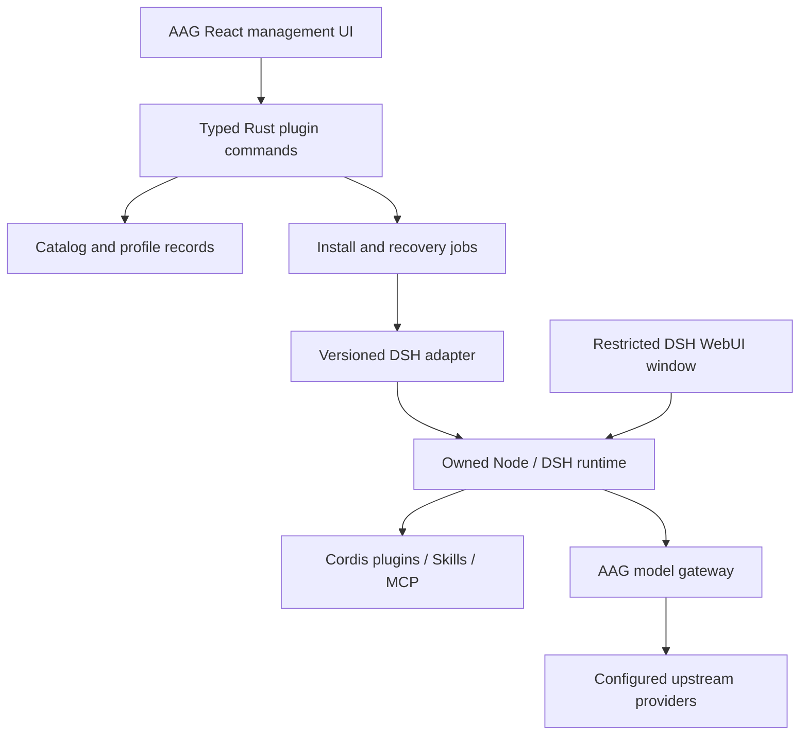

# DSH Plugin Management Research

Research date: 2026-08-30. This is the preserved proposal. See [managed DSH integration](dsh_management.md) for the implemented subset and remaining limits.

This report interprets `dsh` as **DeepSeek Harness**, based on the matching
upstream project and desktop/plugin ecosystem. The user has not separately
confirmed the acronym. A different DSH product would require revisiting the
external contracts below.

## Recommendation

AAG can become the unified **management surface** for DSH plugins. It does not
currently implement that capability. Preserve the existing Tauri/React desktop
and Rust model gateway; run DSH and its Cordis plugins in an independently owned
Node process. Let DSH own plugin execution and session state.

For the first desktop integration, load the original DSH WebUI in a separate,
restricted Tauri window backed by an owned loopback service. Do not rebuild the
DSH conversation UI or replace AAG with an Electron fork. A socketless transport
is a later option that requires a separate compatibility investigation.

The four product tracks are personalization, useful plugins, one-click setup,
and desktop presentation. They should share an inventory and operation model,
but retain distinct adapters for DSH packages, Skills, MCP servers, and native
desktop features. These formats are not interchangeable.

## Inspected baseline and existing capabilities

Local source: `master` at `1fa8e287b9d5eb9926948b0c7bc321de5659656d`.
The working tree was clean before this documentation work. The source, rather
than older phase comments, is authoritative. `PROGRESS.md` separately describes
the unsigned desktop preview and remaining native acceptance work; its historical
test results were not rerun for this research.

| Area | Confirmed implementation | Gap for this proposal |
| --- | --- | --- |
| Desktop shell | React frontend in Tauri 2, tray/lifecycle, theme and locale controls | No DSH runtime or DSH window; native installation/upgrade acceptance remains separate |
| Model gateway | Rust routes `/v1/chat/completions`, `/v1/messages`, and `/v1/responses` | No DSH adapter or end-to-end DSH evidence; Responses is converted through the canonical chat representation |
| Applications | Rust and UI have explicit supported-app types and provider adapters | No DSH target; repository search found no literal `dsh` |
| MCP | SQLite server records and per-app enabled metadata | No live-config synchronization, process supervision, handshake verification, registered IPC, or current management page |
| Skills | SQLite metadata, repository coordinates and a content-hash field | No download/install/update/uninstall service or filesystem distribution; storing a hash is not integrity verification |
| Personalization | AAG appearance preferences | No persona/prompt or DSH plugin-profile manager; existing provider profiles configure credentials/models |
| One-click entry | OS deep-link forwarding, a parser, provider import and launcher building blocks | No plugin import/install flow; current UI does not consume the MCP/Skill parser actions |
| Backup/sync | Atomic file helper, selected-table backups, separate database sync implementations | Backup payload omits MCP/Skills; sync transfers a database, not a plugin environment |

Local evidence:

- [Desktop configuration](../src-tauri/tauri.conf.json),
  [theme](../ui/src/lib/theme.ts), and [application shell](../ui/src/App.tsx).
- [HTTP routes](../src-tauri/src/proxy/server.rs#L233) and
  [app types](../src-tauri/src/services/provider/mod.rs#L23).
- [MCP DAO](../src-tauri/src/database/dao/mcp.rs#L4),
  [Skills DAO](../src-tauri/src/database/dao/skills.rs#L3), and
  [registered commands](../src-tauri/src/lib.rs#L130).
- [Deep-link parser](../src-tauri/src/deeplink_parser.rs#L17) and
  [actual backup payload](../src-tauri/src/database/dao/backup.rs#L29).

Two existing patterns must not be copied as installation guarantees.
`provider_switch` changes database state before its live write, converts write
errors to `None`, and can return success with an empty `written` list. Plugin
operations need explicit failure and partial-completion results.
The backup header mentions more tables than its actual payload includes.
Neither pattern proves plugin rollback exists.
See [provider switching](../src-tauri/src/commands/provider.rs#L56) and
[included backup tables](../src-tauri/src/database/dao/backup.rs#L40).

## Four implementation tracks

| Track | User-facing behavior | Implementation boundary | Initial scope |
| --- | --- | --- | --- |
| Personalization | Named profiles for appearance, selected Skills, tool sets, and nonsecret plugin settings | AAG stores desired selections; the DSH adapter applies supported settings to one selected instance | A small set of user-editable profiles; preserve selected models and explicit-only activation policies |
| Useful plugins | Search, inspect, install, enable, diagnose, update and remove extensions | Catalog metadata is separate from package installation and DSH runtime inventory | A curated allowlist with pinned versions; Skills/MCP get their own adapters |
| One-click setup | Detect or provision a runtime, connect the gateway, apply a chosen profile and verify it | A bounded job coordinates runtime, package, configuration and verification services | Preview changes and permissions once, then execute the approved plan with a durable result |
| WebUI to desktop | Open DSH sessions/tools/settings in an application window, retain tray recovery | Original DSH WebUI in a restricted window; Rust owns its child process and window lifecycle | Loopback sidecar first; bundle runtime assets only after a prototype passes |

Appearance is not necessarily low risk: a theme distributed as a Cordis package
may execute backend code. Prefer declarative appearance settings where possible,
and classify installation risk by executable behavior rather than catalog tags.

### Concrete plugin candidates

These are catalog candidates, not approved installations. Source and license
inspection does not establish dependency safety or runtime compatibility.
Preserve external package names and fields; use snake_case for new AAG IDs.

| Category | Candidate and inspected source | Useful implementation | Adoption condition |
| --- | --- | --- | --- |
| Appearance | [Moeblack/dsh-skins](https://github.com/Moeblack/dsh-skins/blob/10520bdc94b8a621212d280a4a6c6820f28690bd/packages/dsh-web-skins/src/client/index.ts) | Theme registration, settings slots and cleanup of injected styles | Verify current package entry format; the root manifest retains a legacy dshClient field |
| Preferences | [IAMLieutenant/dsh-tool-user-memory](https://github.com/IAMLieutenant/dsh-tool-user-memory/blob/07bd65835c92203042b546a5c64ad4500104aba0/src/index.ts) | Read/update memory tools and per-turn prompt context | Keep disabled by default: current behavior shares memory across workspaces and allows model-initiated writes; require explicit writes, scope control and concurrency protection |
| Cost visibility | [Sttrevens/dsh-cost-meter](https://github.com/Sttrevens/dsh-cost-meter/blob/9f8a924f2496856f671a508aca44bff7d3377770/lib/index.js) | Usage projection and per-message cost display | Treat values as estimates, not billing; validate older peer requirements and redirect its default pricing path for isolated instances |
| Reusable instructions | [Official filesystem Skills provider](https://github.com/deepseek-ai/deepseek-harness/blob/cd5ef8148158c3a752a658978873241fdf8e2bbc/packages/skill/skill-filesystem/README.md) | Scoped discovery, change watching and invocation flags | Preserve disable-model-invocation / user-invocable; do not auto-activate every discovered Skill |
| External tools | [Official MCP client](https://github.com/deepseek-ai/deepseek-harness/blob/cd5ef8148158c3a752a658978873241fdf8e2bbc/packages/mcp/mcp-client/README.md) | stdio and Streamable HTTP tool bridges with reconnection | Verify each server and permissions; this DSH implementation bridges tools, not MCP Resources or Prompts |

The three community candidates have MIT license files at the inspected revisions:
[skins](https://github.com/Moeblack/dsh-skins/blob/10520bdc94b8a621212d280a4a6c6820f28690bd/LICENSE),
[memory](https://github.com/IAMLieutenant/dsh-tool-user-memory/blob/07bd65835c92203042b546a5c64ad4500104aba0/LICENSE),
[cost meter](https://github.com/Sttrevens/dsh-cost-meter/blob/9f8a924f2496856f671a508aca44bff7d3377770/LICENSE).
No price table or claimed package compatibility was accepted as verified behavior.

### Marketplace and recommendation references

**2BingLing/dsh-market** is the closest reference for catalog personalization.
Its [profile module](https://github.com/2BingLing/dsh-market/blob/2c2ebd54219d7d67b7ca78005b3d2ba9a7d9c1da/plugin/core/src/profile.ts)
maps questionnaire answers and other signals into tags; its
[recommendation module](https://github.com/2BingLing/dsh-market/blob/2c2ebd54219d7d67b7ca78005b3d2ba9a7d9c1da/plugin/core/src/recommend.ts)
uses scenario matching and recommendation diversity. For AAG, begin with explicit
local preferences; GitHub account history should be optional and separately
authorized. Recommendation never authorizes installation.

Reuse workflow ideas, not its installer wholesale: the inspected
[installer](https://github.com/2BingLing/dsh-market/blob/2c2ebd54219d7d67b7ca78005b3d2ba9a7d9c1da/plugin/core/src/installer.ts)
has string-based command paths and rollback coverage that does not consistently
restore complete lockfile/runtime state. Its
[license](https://github.com/2BingLing/dsh-market/blob/2c2ebd54219d7d67b7ca78005b3d2ba9a7d9c1da/LICENSE)
covers source/documentation under MIT but reserves brand assets; do not copy its
logo or icons into AAG.

**0326/dsh-plugin-market** provides a useful source-review model: the
[scanner](https://github.com/0326/dsh-plugin-market/blob/62e909757977cfd683dccc7306e9273bfa422396/src/worker/scanner/index.ts)
binds findings to a repository snapshot and commit, while
[security checks](https://github.com/0326/dsh-plugin-market/blob/62e909757977cfd683dccc7306e9273bfa422396/src/worker/scanner/security.ts)
look for lifecycle scripts, dependency and API risk signals. These are static
signals, not a security certification. Its compatibility fallback uses an older
DSH baseline; replace that with an explicit tested-version matrix.
Source license: [MIT](https://github.com/0326/dsh-plugin-market/blob/62e909757977cfd683dccc7306e9273bfa422396/LICENSE).

**Relistencode/dsh-extension-hub** is an additional UI reference for grouping core
and third-party plugins. Its inspected
[plugin implementation](https://github.com/Relistencode/dsh-extension-hub/blob/ef7021ce3263f85e7ac981e095d1ba1370529ca6/lib/plugins.mjs)
includes direct package-directory copying and a hard Git reset during updates.
Those operations do not meet AAG's preservation and recovery requirements; do not
transplant the update implementation.

## Architecture and state ownership

- **AAG owns:** catalog cache, desired plugin bindings, approved operation plans,
  receipts, runtime identity, and its existing provider/routes database.
- **DSH owns:** loaded plugin graph, profile configuration semantics, credentials,
  conversations, approvals, and session logs. Read runtime inventory through its
  supported service; do not infer loaded state from an AAG row.
- **The package manager owns:** dependency resolution and installation layout.
  Never implement updates by overwriting files inside `node_modules`.
- **An AAG-managed instance owns:** its private runtime/configuration directories.
  Attaching to an existing DSH instance starts read-only; do not silently adopt
  or overwrite the user's default DSH environment.

A sidecar separates process failure and ownership; it is **not an OS sandbox**.
In-process Cordis plugins can share the DSH host's privileges. Package trust,
credential access, workspace permissions and optional OS isolation remain
separate controls.

## DSH contracts and one-click setup

The inspected upstream revision is
[`cd5ef8148158c3a752a658978873241fdf8e2bbc`](https://github.com/deepseek-ai/deepseek-harness/commit/cd5ef8148158c3a752a658978873241fdf8e2bbc).
Pin the supported DSH release, package-manager version and adapter version for
any implementation. A desktop wrapper targeting an older release is not proof
of compatibility with this source revision.

The upstream plugin command requires a profile and forwards package operations
to pnpm, then reconciles installed bundles. It is not a complete administrative
API with DSH-owned JSON results, dry-run, enable and disable operations.
`pluginInventory/list` exposes a read-only loaded-plugin snapshot including
`entryId`, `module`, `enabled`, and `phase`; it is not a provenance database or
mutation API. AAG must add its own structured operation adapter and validated
profile-edit workflow.
Sources: [plugin CLI](https://github.com/deepseek-ai/deepseek-harness/blob/cd5ef8148158c3a752a658978873241fdf8e2bbc/apps/cli/src/plugin.ts),
[runtime inventory](https://github.com/deepseek-ai/deepseek-harness/blob/cd5ef8148158c3a752a658978873241fdf8e2bbc/packages/host/plugin-inventory/README.md).

Proposed operation sequence:

1. Identify the target instance, runtime version, profile and current state.
2. Resolve an allowlisted package to an exact version/integrity record. Inspect
   declared dependencies, executable hooks and requested access.
3. Present the target, changes, downloads, permissions and restart requirement.
   A deep link opens this preview; it never silently installs code or carries
   credentials.
4. Acquire a per-instance cross-process lock. Back up only affected configuration
   and package-resolution state, with hashes for concurrent-change detection.
5. Install into an AAG-owned staged profile using structured executable/argument
   values. Do not expose arbitrary shell command strings or unrestricted pnpm
   arguments to the frontend.
6. Apply the validated profile patch; start or restart only the owned runtime.
   Do not discard an active conversation to complete an installation.
7. Read back configuration and runtime inventory, then verify the expected UI or
   tool behavior. Package-manager exit code zero is not enough.
8. Persist the final receipt. If a step fails, restore affected owned state or
   enter safe mode; report rollback failure separately. Never roll back new
   session data or erase the original failure record.

Suggested job states are `planned`, `approved`, `installing`,
`pending_restart`, `verifying`, `succeeded`, `failed`, and `rollback_failed`.
Inventory must separately display `installed`, `configured_enabled`,
`runtime_phase`, and `last_verified_at`. Package presence, enabled configuration
and successful runtime behavior are distinct facts.

Where available, use DSH's settings mutation service and revision checks rather
than editing active files behind its back. Composition changes may still need a
controlled profile patch and restart. Skills refresh through their filesystem
watcher; do not impose package-restart semantics on all capabilities.
The [upstream settings plugin](https://github.com/deepseek-ai/deepseek-harness/blob/cd5ef8148158c3a752a658978873241fdf8e2bbc/packages/client/ui-settings-plugins/README.md)
defines host-plane configuration cards and secret-field handling; inline agent
preset configuration is a separate scope.

### Connecting the model gateway

DSH already supports custom provider routes through `dsh-llm-pi-ai`. Its external
configuration fields include `api`, `baseURL`, `apiKeyEnv`, and `models`.
A proposed route named `aag` can point at the existing gateway's actual bound
loopback port using `openai-completions` first. Preserve the selected model alias;
do not silently switch providers or reasoning settings. Configure only a
dedicated local gateway credential through DSH's credential mechanism, rather
than distributing upstream provider keys into every plugin.
Sources: [provider configuration](https://github.com/deepseek-ai/deepseek-harness/blob/cd5ef8148158c3a752a658978873241fdf8e2bbc/docs/user/guide/providers.md),
[provider adapter](https://github.com/deepseek-ai/deepseek-harness/blob/cd5ef8148158c3a752a658978873241fdf8e2bbc/packages/llm/llm-pi-ai/README.md).

This is a proposed mapping, not tested compatibility. Verify streaming text,
tool calls/results, cancellation, token usage, reasoning fields, image claims,
and error behavior against the selected model/route. Use request-compatibility
settings only when the observed endpoint requires them. AAG takes a proxy
snapshot at startup, so edits to AAG routes require a restart; merely adding a
DSH consumer does not inherently require changing those routes.

DSH search is a separate integration. `web-search-deepseek` resolves
`DEEPSEEK_SEARCH_BASE_URL` independently from the chat base and uses a provider
supporting its native search tool. Routing chat through AAG does not make every
upstream search-capable, and enabling the default search plugin may contact a
different endpoint. Declare and verify search credentials/destination separately.
Source: [search provider configuration](https://github.com/deepseek-ai/deepseek-harness/blob/cd5ef8148158c3a752a658978873241fdf8e2bbc/packages/web/web-search-deepseek/src/index.ts).

## Desktop implementation choices

| Approach | Fit for AAG | Work and limitations |
| --- | --- | --- |
| Open DSH in the external browser | Useful first integration probe | Proves gateway/runtime connection but does not deliver the requested desktop UI |
| Existing Tauri shell + owned DSH sidecar + separate WebView | Recommended initial product implementation | Preserve upstream WebUI; add readiness, authentication, navigation policy, process supervision and native packaging |
| Socketless DSH host + custom IPC carrier | Later research option | Requires adapting HTTP/WebSocket and plugin transport assumptions; an Electron implementation cannot simply be pasted into Rust/Tauri |

### Source-verified desktop references

**qinyre/dsh-Desktop**, inspected at 62d5140b33f6e459626e0c0d4609141247d39ada,
is the most directly relevant lifecycle reference. Its
[startup](https://github.com/qinyre/dsh-Desktop/blob/62d5140b33f6e459626e0c0d4609141247d39ada/desktop/src/main/index.ts)
launches DSH web on an OS-selected loopback port and loads it in a desktop window.
Its [supervisor](https://github.com/qinyre/dsh-Desktop/blob/62d5140b33f6e459626e0c0d4609141247d39ada/desktop/src/main/sidecar/sidecar-manager.ts)
serializes lifecycle operations, rejects stale process events and retries crashes.
Readiness is parsed from output, so AAG should add authenticated behavior checks.
Its [plugin guard](https://github.com/qinyre/dsh-Desktop/blob/62d5140b33f6e459626e0c0d4609141247d39ada/desktop/src/main/plugins/plugin-guard.ts)
and [tray manager](https://github.com/qinyre/dsh-Desktop/blob/62d5140b33f6e459626e0c0d4609141247d39ada/desktop/src/main/plugins/tray-plugin-manager.ts)
are useful patterns for recovery when plugin UI fails.

Important differences: it uses Electron's Node runtime; Tauri must supply its
own. Its four seed plugins are installed on first launch, so bundled runtime does
not imply offline plugin installation. The
[seed orchestration](https://github.com/qinyre/dsh-Desktop/blob/62d5140b33f6e459626e0c0d4609141247d39ada/desktop/src/main/plugins/market-seed.ts)
disables the market's independent restart path so the desktop remains the sole
supervisor. Its [in-place recovery writes](https://github.com/qinyre/dsh-Desktop/blob/62d5140b33f6e459626e0c0d4609141247d39ada/desktop/src/main/plugins/guard-quarantine.ts)
acknowledge concurrent-edit risk; raw child output logging also should not be
copied into AAG diagnostics. This revision targets DSH 0.1.1-rc.2, not the upstream
revision above.

**chengxiaosheng/dsh-desktop**, inspected at
759d4a4085ea255e1806ebdab127ea122141fc5b, demonstrates socketless transport.
Its [composition patch](https://github.com/chengxiaosheng/dsh-desktop/blob/759d4a4085ea255e1806ebdab127ea122141fc5b/packages/dsh-plugin-desktop/cordis.patch.yml)
replaces the webserver and connection rows, and the
[virtual server](https://github.com/chengxiaosheng/dsh-desktop/blob/759d4a4085ea255e1806ebdab127ea122141fc5b/packages/dsh-plugin-desktop/src/webserver.ts)
retains route registration without listening. Electron hosts Cordis and bridges
HTTP/WebSocket behavior through IPC. Its
[host bridge](https://github.com/chengxiaosheng/dsh-desktop/blob/759d4a4085ea255e1806ebdab127ea122141fc5b/packages/dsh-plugin-desktop/electron/host-bridge.ts)
adapts fetch and WebSocket; raw Node HTTP clients need separate handling.
The project depends on system pnpm and a copied upstream connection controller
with a [version-drift gate](https://github.com/chengxiaosheng/dsh-desktop/blob/759d4a4085ea255e1806ebdab127ea122141fc5b/packages/dsh-plugin-desktop-connection/scripts/verify-upstream.mts).
These are additional compatibility costs, not a drop-in Tauri implementation.

Both desktop repositories have MIT top-level licenses at the inspected revisions:
[qinyre](https://github.com/qinyre/dsh-Desktop/blob/62d5140b33f6e459626e0c0d4609141247d39ada/LICENSE),
[chengxiaosheng](https://github.com/chengxiaosheng/dsh-desktop/blob/759d4a4085ea255e1806ebdab127ea122141fc5b/LICENSE).
Any later code reuse must retain required notices and review dependencies and
plugin licenses separately. No code was copied into AAG in this research.

Tauri supports bundled external binaries, including platform-specific sidecars.
This provides a packaging mechanism, not a complete Node/package distribution
or plugin compatibility solution. Preserve dynamic package loading and assets
when deciding how Node and DSH are packaged.
Source: [Tauri sidecars](https://v2.tauri.app/develop/sidecar/).

The current AAG desktop has `csp: null`, a `main` capability with `core:default`,
and no explicit application-command allowlist in `build.rs`. Before introducing
third-party UI, define a CSP and explicit application-command permissions for
the trusted manager window. Give the DSH window no generic AAG native API access;
validate navigation, origins, popups and downloads. A narrow authenticated
backend bridge can mediate the specific management operations it needs.
Do not embed untrusted plugin UI into the privileged manager DOM.

Tauri's documentation notes that registered application commands are available
to app windows by default unless constrained, while remote API access requires
explicit capability configuration. The existing capability file alone is not
evidence of a safe future third-party plugin window.
Sources: [capabilities](https://v2.tauri.app/security/capabilities/),
[local build configuration](../src-tauri/build.rs), and
[local capabilities](../src-tauri/capabilities/default.json).

Loopback does not substitute for authentication. Use an owned listener, runtime
identity, bounded readiness checks, a session-bound authorization mechanism and
WebSocket origin validation. Never forward raw DSH session logs or plugin output
into AAG's metadata-only diagnostics. Keep the tray/recovery surface available
when DSH or a plugin fails.

## Proposed module boundaries

All paths below are proposed, not existing implementations.

| Module | Responsibility |
| --- | --- |
| `src-tauri/src/services/dsh/runtime.rs` | Runtime detection, owned process lifecycle, readiness and version checks |
| `src-tauri/src/services/dsh/profile_adapter.rs` | DSH profile/settings translation, readback, supported upstream contracts |
| `src-tauri/src/services/plugins/catalog.rs` | Catalog acquisition, source identity and compatibility metadata |
| `src-tauri/src/services/plugins/operations.rs` | Install plans, locks, staged changes, receipts and recovery |
| `src-tauri/src/database/dao/plugins.rs` | Catalog/installations/bindings/jobs persistence only |
| `src-tauri/src/commands/plugins.rs` | Typed IPC orchestration and permission checks |
| `ui/src/lib/api/plugins.ts` | Typed plugin DTOs and command wrappers |
| `ui/src/components/plugins/plugin_page.tsx` | Lazy-loaded manager page and operation status |

Keep category, package kind, runtime instance and scope separate. Suggested
records include `plugin_catalog`, `plugin_installations`, `plugin_profiles`,
`plugin_bindings`, and `plugin_operations`. A binding connects a profile to one
installation and nonsecret configuration. Receipts retain source/version,
integrity, before/after hashes, verified runtime identity and a stable error code.
Secret values do not belong in catalogs, shareable profiles or receipts.

Do not build a cross-language shared framework for the first version. Preserve
the independently runnable Node gateway. If headless plugin management is later
required, expose the same versioned adapter contract rather than giving the
legacy runtime permission to edit another runtime's database directly.

## Delivery stages and acceptance

1. **Read-only inventory:** detect one selected DSH instance, report versions,
   profile rows and loaded phases, and display a curated catalog. No auto-install.
2. **One-instance integration:** connect the model gateway and apply one reviewed
   profile in disposable state; verify a real DSH tool round trip against a local
   fixture. External model calls remain a separate authorized check.
3. **Plugin management:** install/update/disable/remove with locking, readback,
   recovery, version pinning and explicit per-plugin results.
4. **Desktop delivery:** bundle runtime assets and load the DSH WebUI in a
   restricted window; verify clean-machine installation, tray behavior, owned
   process cleanup and upgrade recovery on each supported platform.

Required failure cases include an incompatible DSH version, missing package
manager, untrusted package source, traversal/symlink escape, dependency conflict,
malformed settings, failed install, interrupted operation, duplicate operation,
occupied port, crashed plugin, broken UI, changed configuration during install,
and unsuccessful rollback. Test secret redaction and unauthorized native IPC.

Acceptance is not a green HTTP response or catalog row. It requires the intended
plugin to load in the matching runtime, its user-facing behavior to work, and
recovery to preserve user state. Browser demo evidence does not prove native
WebView behavior or installation. No DSH runtime, community plugin, desktop
wrapper, or external provider was executed during this research.

The inspected upstream [safety notice](https://github.com/deepseek-ai/deepseek-harness/blob/cd5ef8148158c3a752a658978873241fdf8e2bbc/SAFETY.md)
describes a developer preview without a completed security audit. Catalog
visibility, open source availability and a local demonstration must not be
presented as production readiness.
